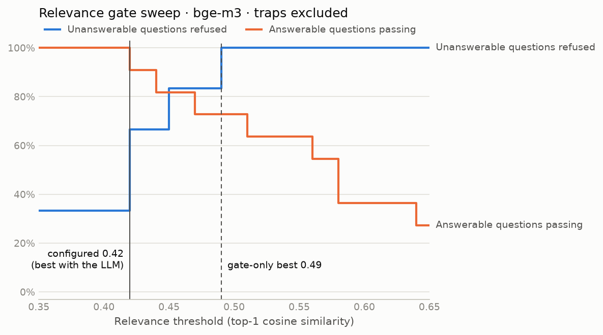

# talk-to-my-cv

🇬🇧 [Read in English](README.md)

**Aprendé RAG en un día armando un chat con tu CV. 100% local y gratis.**

## Inicio rápido

Requisitos: [uv](https://docs.astral.sh/uv/), Docker y [Ollama](https://ollama.com) corriendo nativo.

```bash
git clone https://github.com/pablothx/talk-to-my-cv && cd talk-to-my-cv
cp .env.example .env
ollama pull bge-m3 && ollama pull qwen2.5:3b
make install
make up
make doctor
```

## Pasos

| Paso | Lección | Tag |
|------|---------|-----|
| 0 | [Setup](lessons/00-setup/README.es.md) | `step-00` |
| 1 | [Embeddings](lessons/01-embeddings/README.es.md) | `step-01` |
| 2 | [Chunking e ingesta](lessons/02-chunking-ingestion/README.es.md) | `step-02` |
| 3 | [Primer RAG](lessons/03-first-rag/README.es.md) | `step-03` |
| 4 | [Citas y umbral](lessons/04-citations-threshold/README.es.md) | `step-04` |
| 5 | [Evaluación](lessons/05-evaluation/README.es.md) | `step-05` |
| 6 | [Búsqueda híbrida con OpenSearch](lessons/06-hybrid-search/README.es.md) | `step-06` |
| 7 | [LangGraph y verificación](lessons/07-langgraph/README.es.md) | `step-07` |
| 8 | [API y página web](lessons/08-api-and-web/README.es.md) | `step-08` |
| Bonus | [Producción en AWS](docs/produccion-en-aws.md) | — |

## ¿Qué tan bien anda?

Cada cambio se mide con 20 preguntas sobre una persona ficticia ([paso 5](lessons/05-evaluation/README.es.md)):



## Usalo con tu propio CV

Lo más rápido: poné tu CV en PDF en `kb/`, configurá `KB_DIR=kb` en `.env` y corré `make ingest`. Las líneas en MAYÚSCULAS (`PROFESSIONAL EXPERIENCE`) pasan a ser secciones, y las que terminan en un rango de años (`Senior Engineer, Acme (2021 – Present)`) arman un pedazo por cada trabajo. No interviene ningún LLM, así que no se inventa nada.

Para mejores respuestas, escribilo en Markdown (con la misma forma que `kb.example/`): elegís las secciones y podés agregar lo que el PDF no dice, como "HubSpot (CRM)" o "never used Kubernetes in production". PDF y Markdown pueden convivir. Todo lo que esté en una carpeta que empieza con `_` (como `kb/_drafts/`) se ignora, y `kb/` está en `.gitignore`, así que tu CV nunca se commitea.

## Licencia

[MIT](LICENSE)
