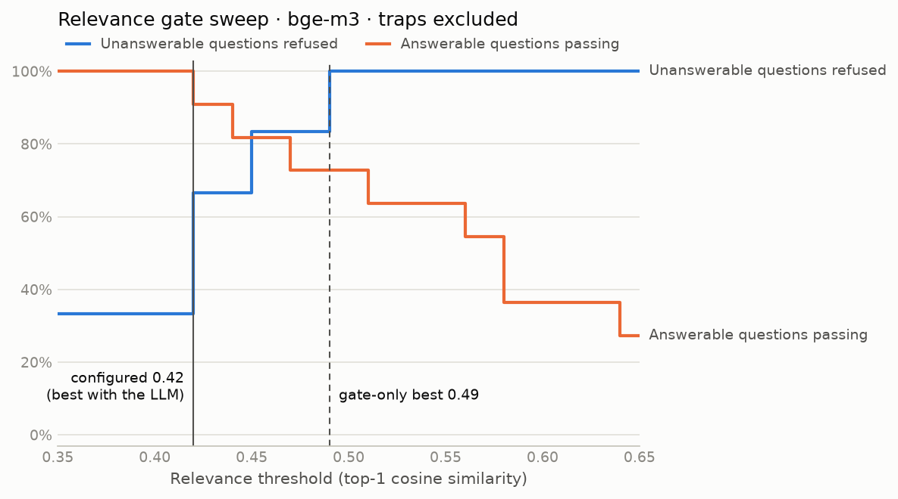

# talk-to-my-cv

🇪🇸 [Leer en español](README.es.md)

**Learn RAG in one day by building a chat with your CV. 100% local and free.**

## Quickstart

Requirements: [uv](https://docs.astral.sh/uv/), Docker, and [Ollama](https://ollama.com) running natively.

```bash
git clone https://github.com/pablothx/talk-to-my-cv && cd talk-to-my-cv
cp .env.example .env
ollama pull bge-m3 && ollama pull qwen2.5:3b
make install
make up
make doctor
```

## Steps

| Step | Lesson | Tag |
|------|--------|-----|
| 0 | [Setup](lessons/00-setup/README.md) | `step-00` |
| 1 | [Embeddings](lessons/01-embeddings/README.md) | `step-01` |
| 2 | [Chunking and ingestion](lessons/02-chunking-ingestion/README.md) | `step-02` |
| 3 | [First RAG](lessons/03-first-rag/README.md) | `step-03` |
| 4 | [Citations and threshold](lessons/04-citations-threshold/README.md) | `step-04` |
| 5 | [Evaluation](lessons/05-evaluation/README.md) | `step-05` |
| 6 | [Hybrid search with OpenSearch](lessons/06-hybrid-search/README.md) | `step-06` |
| 7 | [LangGraph and verification](lessons/07-langgraph/README.md) | `step-07` |
| 8 | [API and web page](lessons/08-api-and-web/README.md) | `step-08` |
| Bonus | [Production on AWS](docs/production-on-aws.md) | — |

## How well does it work?

Every change is measured against 20 questions about a fictional persona ([step 5](lessons/05-evaluation/README.md)):



## Use it with your own CV

Put your Markdown in `kb/` (same shape as `kb.example/`), set `KB_DIR=kb` in `.env`, and run `make ingest`. Files under `kb/_drafts/` are ignored.

## License

[MIT](LICENSE)
