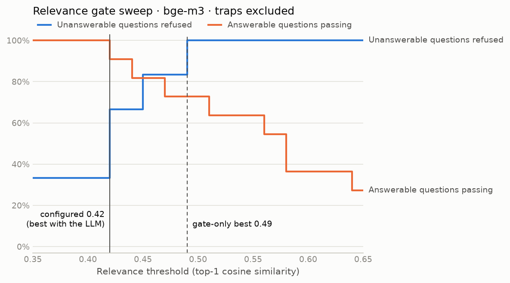

# Paso 5: Evaluación

🇬🇧 [Read in English](README.md)

## Qué vas a aprender

- A medir un RAG con números en lugar de "probé tres preguntas y anduvo".
- Qué miden **hit@k**, **MRR**, **refusal accuracy** y **answer accuracy**.
- A calibrar el umbral de relevancia con datos, y por qué el mejor umbral "en los papeles" no es el mejor en la práctica.
- Qué es **sobreajustar** y por qué estos números son optimistas.

## El concepto

### Las preguntas

`eval/questions.yaml` tiene 20 preguntas sobre Valentina Ríos, 10 en inglés y 10 en español:

| Tipo | Cuántas | Qué se espera |
|------|--------:|---------------|
| `answerable` | 7 | Que responda, cite la sección correcta e incluya los datos clave (`must_contain`). |
| `planted` | 5 | Lo mismo, con datos imposibles de adivinar (por ejemplo, "14 minutes" o "Golden Pigeon"): prueba que la respuesta sale del documento y no de la memoria del modelo. |
| `negation` | 1 | Que responda "no", citando la fuente. Ni rechazar ni afirmar. |
| `unanswerable` | 7 | Que rechace. Incluye fuera de tema, datos privados y prompt injection. |

Tres preguntas están marcadas como **trampas** (JavaScript, CRM y Kubernetes, de los pasos 1 a 4). Fallan a propósito con búsqueda vectorial, así que se reportan aparte y no cuentan para los objetivos. El paso 6 va a mostrar si la búsqueda híbrida las arregla.

Un test valida el YAML en CI: mínimos por tipo, los dos idiomas, y que cada fuente esperada exista de verdad en los chunks de la KB. Si alguien cambia un título de `kb.example/` y rompe una pregunta, CI lo detecta.

### Las métricas

| Métrica | Pregunta que contesta | Sobre qué preguntas |
|---------|----------------------|---------------------|
| **hit@5** | ¿La sección correcta está entre los 5 chunks recuperados? | Las que tienen respuesta. |
| **MRR** | ¿En qué posición aparece? Vale 1 si es la primera, 0.5 si es la segunda, etc., promediado. | Las que tienen respuesta. |
| **refusal accuracy** | ¿Rechazó cuando debía, y respondió cuando debía? | Todas. |
| **answer accuracy** | ¿La respuesta es correcta del todo: no rechaza, dice "no" si es negación, incluye los datos clave, respeta el idioma? | Todas. |

hit@5 y MRR miden **la búsqueda**. Las otras dos miden **el sistema completo**, con el LLM.

### Calibrar el umbral

`make eval-sweep` hace **una búsqueda por pregunta, sin LLM**, y prueba todos los umbrales entre 0.35 y 0.65. Para cada uno calcula qué porcentaje de las preguntas sin respuesta rechazaría el corte y qué porcentaje de las preguntas con respuesta dejaría pasar. Tarda 9 segundos.



Si las dos curvas se cruzaran limpias, habría un umbral perfecto. No se cruzan limpias: hay preguntas con respuesta que puntúan **por debajo** de preguntas sin respuesta.

| Pregunta | Top-1 | ¿Tiene respuesta? |
|----------|------:|:-----------------:|
| ¿Trabajó con Azure? | 0.483 | no |
| ¿Dónde trabaja actualmente y qué rol tiene? | 0.466 | sí |
| ¿Cuánto cobra por mes? | 0.444 | no |
| How big is the team she leads? | 0.431 | sí |
| What did she study? | 0.414 | sí |

Mirando solo el corte, el mejor umbral es **0.49**: rechaza todas las preguntas sin respuesta, pero también 3 que sí tenían. Corrimos la eval completa, con el LLM, en los dos candidatos:

| Umbral | refusal accuracy | answer accuracy | hit@5 | MRR |
|---|---:|---:|---:|---:|
| 0.49 (el mejor "solo corte") | 0.82 | 0.76 | 1.00 | 0.82 |
| **0.42** | **0.88** | **0.82** | 1.00 | 0.82 |

**0.42 es mejor**, porque el corte no es el único que rechaza: con 0.42, "¿Cuánto cobra?" y "¿Trabajó con Azure?" pasan el corte y **el LLM las rechaza bien**. Con 0.49, en cambio, el corte rechaza preguntas que el LLM nunca llega a ver. Un rechazo de más no tiene arreglo; una respuesta de más todavía puede rechazarla el LLM.

Por eso el barrido solo **propone** candidatos y la eval completa **decide** ([ADR-0009](../../docs/adr/0009-top1-gate-does-not-separate-alone.md)). Quedó `relevance_threshold: 0.42` en `config/models.yaml`.

**El objetivo era refusal accuracy ≥ 0.9, y no llegamos: 0.88.** No lo vamos a "arreglar" tocando la KB o el prompt hasta que pase, porque eso sería sobreajustar (ver más abajo). El paso 7 agrega una verificación con el LLM después de la búsqueda.

## El código

| Archivo | Qué hace |
|---------|----------|
| `src/talk_to_my_cv/evaluation.py` | Métricas, `grade()` (la nota de cada pregunta), `load_questions()`, `run_eval()`, reportes y `sweep()`. |
| `src/talk_to_my_cv/sweep_plot.py` | El gráfico del barrido. |
| `eval/questions.yaml` | Las 20 preguntas. Cada trampa está explicada en un comentario. |
| `eval/results/` | Un resumen `.md` y un `.json` por corrida, que se commitean. Lo crudo va a `raw/`, que no se commitea. |

La eval siempre corre contra `kb.example/`, en su propio esquema de Postgres (`eval`), sin importar tu `KB_DIR`: las preguntas son sobre Valentina, no sobre vos.

## Cómo comprobar que anda

```bash
make check-05
make eval-sweep                      # 9 s, sin LLM
make eval                            # ~1.5 min con qwen2.5:3b en CPU
make eval THRESHOLD=0.49             # otro candidato
make eval MODE=hybrid                # pgvector no lo soporta: sale "skipped"
```

### Lo que nos costó

**1. Un bug que solo la eval podía encontrar.** "¿Dónde trabaja actualmente?" fallaba con "no se especifica su lugar de trabajo". El chunk `Senior Backend Engineer` no contiene la palabra "Northwind": la empresa solo está en el título del documento, que iba en la ruta de títulos del **texto embebido** pero no en el texto que recibía el **LLM**. La búsqueda lo encontraba y el LLM no podía leerlo. Ahora el LLM recibe lo mismo que vio el embedding. Ningún test de los pasos anteriores lo habría detectado.

**2. La instrucción de idioma traduce nombres propios.** "¿Dio alguna charla?" respondió con la charla "Tu libro de transacciones es un flujo". El título real es "Your ledger is a stream". Es efecto secundario de la instrucción explícita de idioma del paso 4, y la eval lo marca como incorrecto. **No lo arreglamos acá a propósito**: ajustar el prompt mirando esta pregunta sería sobreajustar.

**3. El evaluador también se equivoca.** Para JavaScript, el modelo respondió "No, the CONTEXT does not mention any experience with JavaScript.". Está mal, porque no es el rechazo fijo, pero nuestra heurística `asserts_no` la clasifica como "alucinación", y no lo es: admite que no sabe. Un evaluador basado en reglas tiene límites; un LLM juez (más adelante) lo haría mejor.

**4. Una corrida no alcanza.** Como vimos en el paso 4, Ollama en CPU no es determinístico. Antes de creerle a una diferencia chica entre dos corridas, repetila.

> ### Sobreajuste
>
> Calibramos el umbral **con las mismas 20 preguntas** con las que después reportamos los resultados. En machine learning eso se llama **sobreajustar** (*overfitting*): elegimos lo que mejor funciona con *estas* preguntas, y nada garantiza que funcione igual con preguntas nuevas. Con 20 preguntas, mover una sola de lugar cambia las métricas un 5%.
>
> Por eso 0.88 es un número **optimista**. La práctica correcta es separar las preguntas en dos grupos: uno para calibrar y otro, que nunca miraste, para reportar. Con 20 preguntas no alcanza para separar; con 100, sí.

## Para jugar

1. **Probá el sobreajuste vos.** Escribí 5 preguntas nuevas sobre Valentina en `eval/questions.yaml`: 3 con respuesta y 2 sin respuesta, sin mirar los scores antes. Corré `make eval-sweep` y `make eval`. ¿Siguen funcionando el umbral y las métricas? ¿El mejor umbral se movió?
2. **Arreglá la trampa de CRM.** En `kb.example/experience/northwind-payments.md` cambiá "HubSpot" por "HubSpot (CRM)", re-ingestá y corré la eval. `trap-crm` debería pasar. ¿Es trampa arreglarlo? Sí, si lo hacés mirando la pregunta; no, si es una regla general de cómo escribir tu KB ("Herramienta (categoría)").
3. **Probá con otro modelo.** Cambiá `LLM_MODEL` (por ejemplo, `qwen2.5:7b` si te da la RAM) y compará los resúmenes de `eval/results/`. Si tenés una key de Groq, `LLM_PROVIDER=groq`.
