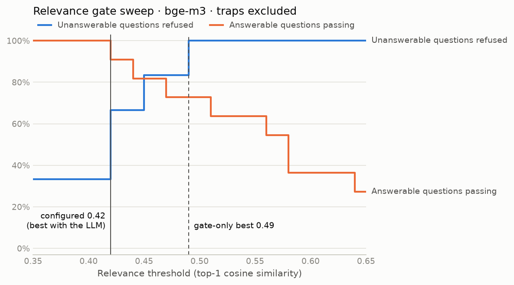

# Step 5: Evaluation

🇪🇸 [Leer en español](README.es.md)

## What you'll learn

- How to measure a RAG with numbers instead of "I tried three questions and it worked".
- What **hit@k**, **MRR**, **refusal accuracy** and **answer accuracy** measure.
- How to calibrate the relevance threshold with data, and why the best threshold "on paper" isn't the best in practice.
- What **overfitting** is, and why these numbers are optimistic.

## The concept

### The questions

`eval/questions.yaml` has 20 questions about Valentina Ríos, 10 in English and 10 in Spanish:

| Type | How many | What is expected |
|------|---------:|------------------|
| `answerable` | 7 | It answers, cites the right section and includes the key facts (`must_contain`). |
| `planted` | 5 | The same, with facts nobody could guess (for example, "14 minutes" or "Golden Pigeon"): this proves the answer comes from the document and not from the model's memory. |
| `negation` | 1 | It answers "no", citing the source. Neither refuse nor affirm. |
| `unanswerable` | 7 | It refuses. Includes off-topic questions, private data and prompt injection. |

Three questions are marked as **traps** (JavaScript, CRM and Kubernetes, from steps 1 to 4). They fail on purpose with vector search, so they're reported apart and don't count toward the targets. Step 6 will show whether hybrid search fixes them.

A test validates the YAML in CI: minimums per type, both languages, and that every expected source really exists among the KB's chunks. If someone renames a heading in `kb.example/` and breaks a question, CI catches it.

### The metrics

| Metric | Question it answers | Over which questions |
|--------|--------------------|----------------------|
| **hit@5** | Is the right section among the 5 retrieved chunks? | Those with an answer. |
| **MRR** | At what position does it show up? 1 if first, 0.5 if second, and so on, averaged. | Those with an answer. |
| **refusal accuracy** | Did it refuse when it should, and answer when it should? | All of them. |
| **answer accuracy** | Is the answer fully right: no refusal, "no" for a negation, key facts included, language respected? | All of them. |

hit@5 and MRR measure **the search**. The other two measure **the whole system**, LLM included.

### Calibrating the threshold

`make eval-sweep` runs **one search per question, without the LLM**, and tries every threshold between 0.35 and 0.65. For each one it computes what share of the unanswerable questions the gate would refuse, and what share of the answerable ones it would let through. It takes 9 seconds.



If the two curves crossed cleanly, there'd be a perfect threshold. They don't: some answerable questions score **below** some unanswerable ones.

| Question | Top-1 | Has an answer? |
|----------|------:|:--------------:|
| ¿Trabajó con Azure? *(Did she work with Azure?)* | 0.483 | no |
| ¿Dónde trabaja actualmente y qué rol tiene? *(Where does she work now, and in what role?)* | 0.466 | yes |
| ¿Cuánto cobra por mes? *(How much does she earn per month?)* | 0.444 | no |
| How big is the team she leads? | 0.431 | yes |
| What did she study? | 0.414 | yes |

Looking at the gate alone, the best threshold is **0.49**: it refuses every unanswerable question, but also 3 that did have an answer. We ran the full eval, with the LLM, on both candidates:

| Threshold | refusal accuracy | answer accuracy | hit@5 | MRR |
|---|---:|---:|---:|---:|
| 0.49 (the best "gate only") | 0.82 | 0.76 | 1.00 | 0.82 |
| **0.42** | **0.88** | **0.82** | 1.00 | 0.82 |

**0.42 is better**, because the gate isn't the only thing that refuses. At 0.42, the salary and Azure questions get through the gate and **the LLM refuses them correctly**. At 0.49, the gate refuses questions the LLM never gets to see. An extra refusal can't be undone; an extra answer can still be refused by the LLM.

That's why the sweep only **proposes** candidates and the full eval **decides** ([ADR-0009](../../docs/adr/0009-top1-gate-does-not-separate-alone.md)). `config/models.yaml` now says `relevance_threshold: 0.42`.

**The target was refusal accuracy ≥ 0.9, and we didn't reach it: 0.88.** We won't "fix" it by tweaking the KB or the prompt until it passes, because that would be overfitting (see below). Step 7 adds an LLM verification step after the search.

## The code

| File | What it does |
|------|--------------|
| `src/talk_to_my_cv/evaluation.py` | Metrics, `grade()` (each question's verdict), `load_questions()`, `run_eval()`, reports and `sweep()`. |
| `src/talk_to_my_cv/sweep_plot.py` | The sweep chart. |
| `eval/questions.yaml` | The 20 questions. Each trap is explained in a comment. |
| `eval/results/` | One `.md` and one `.json` summary per run, committed. Raw output goes to `raw/`, which isn't committed. |

The eval always runs against `kb.example/`, in its own Postgres schema (`eval`), whatever your `KB_DIR` says: the questions are about Valentina, not about you.

## Check that it works

```bash
make check-05
make eval-sweep                      # 9 s, no LLM
make eval                            # ~1.5 min with qwen2.5:3b on a CPU
make eval THRESHOLD=0.49             # another candidate
make eval MODE=hybrid                # pgvector doesn't support it: reported as "skipped"
```

### What was hard

**1. A bug only the eval could find.** "Where does she work now?" failed with "her workplace isn't specified". The `Senior Backend Engineer` chunk doesn't contain the word "Northwind": the company only appears in the document title, which went into the heading path of the **embedded text** but not into the text the **LLM** received. Search found the chunk, and the LLM couldn't read the answer in it. Now the LLM gets the same thing the embedding saw. No test from the earlier steps would have caught it.

**2. The language instruction translates proper names.** "¿Dio alguna charla?" ("Did she give any talks?") came back with the talk "Tu libro de transacciones es un flujo". The real title is "Your ledger is a stream". It's a side effect of step 4's explicit language instruction, and the eval marks it wrong. **We deliberately don't fix it here**: tuning the prompt while looking at this question would be overfitting.

**3. The grader makes mistakes too.** For JavaScript, the model answered "No, the CONTEXT does not mention any experience with JavaScript.". That's wrong, because it isn't the fixed refusal, but our `asserts_no` heuristic labels it a "hallucination", and it isn't one: it admits it doesn't know. A rule-based grader has limits; an LLM judge (later on) would do better.

**4. One run isn't enough.** As we saw in step 4, Ollama on a CPU isn't deterministic. Before you believe a small difference between two runs, repeat them.

> ### Overfitting
>
> We calibrated the threshold **on the same 20 questions** we then report results on. In machine learning, that's called **overfitting**: we picked whatever works best on *these* questions, and nothing guarantees it works as well on new ones. With 20 questions, moving a single one changes the metrics by 5%.
>
> That's why 0.88 is an **optimistic** number. The right practice is to split the questions in two: one set to calibrate, and another, never looked at, to report on. 20 questions aren't enough to split; 100 are.

## Play with it

1. **Test the overfitting yourself.** Write 5 new questions about Valentina in `eval/questions.yaml`: 3 answerable and 2 unanswerable, without looking at the scores first. Run `make eval-sweep` and `make eval`. Do the threshold and the metrics still hold? Did the best threshold move?
2. **Fix the CRM trap.** In `kb.example/experience/northwind-payments.md`, change "HubSpot" to "HubSpot (CRM)", re-ingest and run the eval. `trap-crm` should pass. Is fixing it cheating? Yes, if you do it while looking at the question; no, if it's a general rule for writing your KB ("Tool (category)").
3. **Try another model.** Change `LLM_MODEL` (for example, `qwen2.5:7b` if your RAM allows) and compare the summaries in `eval/results/`. If you have a Groq key, try `LLM_PROVIDER=groq`.
